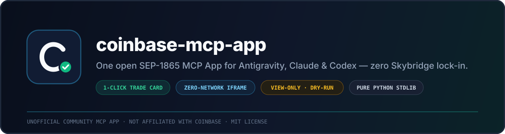

<div align="center">
  <picture>
    <source media="(prefers-color-scheme: dark)" srcset=".github/assets/banner-dark.svg">
    <source media="(prefers-color-scheme: light)" srcset=".github/assets/banner-light.svg">
    
  </picture>

  <p>
    
    
    
    
  </p>
</div>

> **Unofficial community project.** Not affiliated with, endorsed by, or maintained by Coinbase.

**One local open-source SEP-1865 MCP App** for Coinbase Advanced Trade Spot that renders an interactive **1-click trade confirmation card** and **live portfolio panel** natively inside **Google Antigravity**, **Claude Desktop / Claude Code**, and **ChatGPT / Codex Desktop** — with **zero Skybridge lock-in**, **zero external network calls inside the UI iframe**, and **zero third-party Python runtime dependencies**.

## Why Build This?

| Capability | Coinbase Generic Remote MCP | Coinbase Official ChatGPT Plugin | **`coinbase-mcp-app`** |
| --- | --- | --- | --- |
| **Antigravity Desktop** | Blocked by OAuth client allowlist | Blocked + `window.openai` lock-in | **Native inline card + side pane / sidebar** |
| **Claude Desktop / Code** | No inline confirmation card | Widget uses ChatGPT-only Skybridge | **Native inline card (closed-CSP HTML)** |
| **ChatGPT / Codex Desktop** | No inline confirmation card | Supported (ChatGPT only) | **Native local `stdio` SEP-1865 card** |
| **Execution Safety** | Model can call write tools if scoped | Cloud iframe boundary | **`view`-only key + `visibility:["app"]` + hidden HMAC token + dry-run by default** |
| **Runtime Dependencies** | Hosted OAuth | Hosted OAuth | **Pure Python 3.12+ stdlib** (ES256 P-256 + RFC 6979) |

## Safety First (View-Only & Dry-Run By Default)

- **Fail-closed `view`-only preflight (`GET /api/v3/brokerage/key_permissions`):** Refuses to start if `can_trade` or `can_transfer` is enabled on your Coinbase CDP API key.
- **Hidden app-only buttons:** `coinbase_order_execute`, `coinbase_order_cancel`, `coinbase_order_reject`, and `coinbase_order_preview_refresh` declare `_meta.ui.visibility: ["app"]` + `openai/widgetAccessible: true` and reject any raw trade parameters (`additionalProperties: false`).
- **Ephemeral HMAC tokens stripped from LLM context:** `_meta["coinbaseApp/confirmationToken"]` is never placed in `content` or `structuredContent`, rotates on every quote refresh, expires on TTL, and enforces single-use nonces with idempotent `check_status: true` recovery.
- **Dry-run only out of the box:** Clicking **Approve Trade (Dry Run)** persists a local receipt in owner-only (`0700`/`0600`) SQLite and **never places a live order**. Real money execution requires a separate hardware biometric signer outside the agent harness (macOS Keychain Touch ID / 1Password Touch ID).
- **Exact decimal & cash hygiene:** Keeps `USD` fiat and `USDC` / stablecoins strictly separate (Coinbase's portfolio endpoint marks both `is_cash=true`) and preserves exact string decimals.

## Quick Install

### 1. Google Antigravity (1 command)

```bash
agy plugin install https://github.com/saariuslystoned/coinbase-mcp-app
```

Then set `COINBASE_KEY_FILE` (or place your mode-`0600` view-only ECDSA CDP key at `~/.config/coinbase-mcp-app/view-key.json`), or try instant synthetic demo mode (`--demo`). Open **Coinbase Spot** from the left sidebar or **`+`** side-pane menu, or ask:

> *"Preview buying \$10 of BTC-USDC on Coinbase"*

### 2. Claude Desktop / Claude Code

```bash
git clone https://github.com/saariuslystoned/coinbase-mcp-app
claude mcp add --scope user coinbase-mcp-app \
  -e COINBASE_KEY_FILE="$HOME/.config/coinbase-mcp-app/view-key.json" \
  -- /path/to/coinbase-mcp-app/bin/coinbase-mcp-app
```

Or add to `~/Library/Application Support/Claude/claude_desktop_config.json`:

```json
{
  "mcpServers": {
    "coinbase-mcp-app": {
      "command": "bash",
      "args": ["/path/to/coinbase-mcp-app/bin/coinbase-mcp-app"],
      "env": {
        "COINBASE_KEY_FILE": "/path/to/view-key.json"
      }
    }
  }
}
```

### 3. Codex (`~/.codex/config.toml`)

```toml
[mcp_servers.coinbase-mcp-app]
command = "bash"
args = ["/path/to/coinbase-mcp-app/bin/coinbase-mcp-app"]

[mcp_servers.coinbase-mcp-app.env]
COINBASE_KEY_FILE = "/path/to/view-key.json"
```

### Instant Demo Mode (Zero API Key Needed)

Pass `--demo` (or `COINBASE_MCP_DEMO=1`) to render the full portfolio panel and 1-click dry-run trade card using clearly badged `DEMO · SYNTHETIC` data:

```bash
./bin/coinbase-mcp-app --demo
```

## Creating a View-Only Coinbase CDP Key

1. Open the Coinbase Developer Platform portal → **API Keys** → **Create API key**.
2. Select **ECDSA (`ES256`)** (Ed25519 is not supported by Coinbase Advanced Trade REST).
3. Enable **`View` ONLY** (`Trade` **OFF**, `Transfer` **OFF**) and add your IP allowlist.
4. Save outside any Git repo with owner-only permissions:
   ```bash
   mkdir -p ~/.config/coinbase-mcp-app && chmod 700 ~/.config/coinbase-mcp-app
   chmod 600 ~/.config/coinbase-mcp-app/view-key.json
   ```

## Development & Verification

```bash
# Run pure-stdlib unit + stdio tests (zero third-party Python packages)
python3 -S -m unittest discover -s tests -v

# Validate Antigravity plugin manifest strictly
agy plugin validate --strict .

# Rebuild single-file zero-network @modelcontextprotocol/ext-apps HTML card
cd mcp-app-ui && npm ci && npm run build
```

## License

[MIT](LICENSE)
